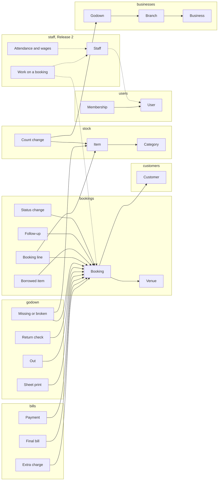

# Architecture

How the code is organised. What is planned: `docs/PLAN.md`. Why: `docs/adr/`.

The layers and the inside of every app are decided (ADR-0007). The list of
apps is a plan: each app's place is checked again when it is built, and an
open decision below gets its ADR first.

---

## What we optimise for

- **Availability is always right.** Nobody can promise pieces that are
  out, booked or missing. This is the client's first rule.
- **Correct money.** Every rupee traceable to the record that moved it.
- **Safe for many businesses.** No data can cross from one business to
  another (ADR-0012).
- **Nothing lost.** A record is never deleted; a cancelled or changed one is
  kept and marked.
- **Easy to change.** Every rule has one home, so anyone can say which file
  to change when a rule changes.
- **Simple to run.** One application and one database per deployment.

## Deployment model

One repository and one codebase, on every server (ADR-0012):
- **dedicated:** one business on its own server;
- **shared:** many businesses on one server, each seeing only its own data.

What differs between servers is configuration (environment variables), and
between businesses their own settings, never code.

## Project layout

```
rentalos/
├── apps/              all Django apps (below)
├── config/            settings (base, local, test), urls, wsgi, health check
├── tests/             project-wide tests (settings, safe defaults, layers, keys)
├── docs/
├── .github/           CI and the pull request template
├── pyproject.toml     dependencies, ruff, import-linter and pytest settings
├── uv.lock            exact versions of every dependency
└── manage.py, README.md, CLAUDE.md, CONTRIBUTING.md, LICENSE, .env.example,
    .pre-commit-config.yaml
```

Each comes with the step that first needs it (`docs/PLAN.md`):
`templates/` (base layouts, shared components, state pages), `static/`
(design system CSS, icons, shared JS, htmx), `locale/` (Malayalam, when
wanted), `design/lab/system/` (the design system's lab page, never
imported by the app), and `config/settings/production.py`.

## Apps: small, each answering one question

| App | Holds | Built in |
|---|---|---|
| `core` | shared tools: the base model that gives every model its UUID7 key (ADR-0008); later money, Indian formats, template helpers. No business rules | step 0 |
| `users` | users, their memberships (each with its role), and sign-in | step 0 (the user), step 1 |
| `businesses` | the business, its branches and godowns; the base of every business record | step 1 |
| `stock` | items, categories, item photos, how many pieces each item has | step 3 |
| `customers` | event companies and direct parties | step 4 |
| `bookings` | estimates, follow-ups, bookings with their event details, venues, borrowed items | step 4 |
| `godown` | the Loading Sheet, Out, the return check, the Missing & Damage list, Recovered | step 5 |
| `bills` | extra charges, the final bill, the discount, the round-off, payments, the balance | step 6 |
| `reports` | the owner dashboard, if one is wanted; read-only | to decide |
| `staff` | staff, their work on bookings, attendance, wages (Release 2) | step 9 |

An app is created with its first real code: a model, a page or a shared
tool. No empty apps.

## Layers: who may import whom

```
Top        reports                   (nothing imports it)
Business   bills
           godown, staff
           bookings
           stock, customers
Base       users
           businesses
           core
```

- An app may import only from apps in **lower rows**, never the same row,
  never above.
- **Model links follow the same rule.** A model links only to its own app's
  models or to lower rows. A link written as text
  (`ForeignKey("bookings.Booking")`) needs no import, so import-linter cannot
  see it; a test does.
- A lower app never reads an upper one. When it needs data that an upper app
  creates, the upper app's service passes it down.
- `staff` sits above `bookings`, because staff are given work on a booking.
  Release 2 then adds its app without changing Release 1.
- The row order lives in the `import-linter` settings in `pyproject.toml`,
  so it has one home. `tests/test_layers.py` runs import-linter and checks
  every model link against the same rows. A new app is placed there in the
  same commit.

## Data map

Every record of Release 1, its links, and where Release 2 joins. Each
part's plan settles its own fields, and changes this map in the same pull
request.

- **Every record belongs to one business** (ADR-0012); the user is the one
  exception. A record marked "Yes" under Branch also belongs to a branch.
  These two links are left out of the picture, so it stays readable.
- **A link points down the layers:** every arrow goes from a record to a
  record it links to, in its own app or a lower one. The dotted arrows are
  Release 2.
- **Availability has no record here yet.** What holds pieces (a booking, a
  load not back, missing pieces) is read from these records. Where the
  holds are kept is open decision 5.
- **Recommended for step 4's plan:** an estimate and its booking are one
  record, so one number runs from the estimate to the final bill, as in the
  approved design.



| Record | App | Branch | What it holds |
|---|---|---|---|
| Business | `businesses` | | The rental business, with the details printed on the Loading Sheet and the bills |
| Branch | `businesses` | | A separate unit of the business, with its own godowns. One today |
| Godown | `businesses` | Yes | A storage place. One today |
| User | `users` | | A person who signs in. Belongs to no business: their membership does |
| Membership | `users` | | A user's place in the business, with their role (`docs/rules/roles.md`) |
| Category | `stock` | | A group of items. Four today |
| Item | `stock` | | One type of thing rented out: its photo, name, rent and purchase price. Its pieces are counted per godown |
| Count change | `stock` | Yes | One change to the pieces of an item in a godown: how many in or out, why, who and when. A charged piece writes one too, so the pieces owned are the sum of these rows |
| Customer | `customers` | | An event company or a direct party, with a phone number |
| Venue | `bookings` | | Where events happen, with its map link, typed once |
| Booking | `bookings` | Yes | From the estimate to the final bill: the customer, the venue, the event details with the loading time and expected back, the site manager's name, and the status |
| Booking line | `bookings` | Yes | The pieces of one item on a booking, with the rent saved when it was added, so a later rent change never changes it |
| Borrowed item | `bookings` | Yes | An item taken from another event group for one booking: its pieces, its cost to us, its rent, and when it was given back |
| Follow-up | `bookings` | Yes | When to call the customer back about an estimate, and what was said |
| Status change | `bookings` | Yes | One row per change of a booking's status, with who and when. A cancel keeps its reason |
| Sheet print | `godown` | Yes | Each print of a Loading Sheet, with when, so an older paper is caught |
| Out | `godown` | Yes | A load leaving the godown: who, when, and the pieces loaded on each line. A second trip is a second Out (`docs/MODULES.md`, point 11) |
| Return check | `godown` | Yes | The count of what came back: on each line, the pieces back and broken |
| Missing or broken | `godown` | Yes | Pieces of one item from a return check, missing or broken: open, then recovered or charged |
| Extra charge | `bills` | Yes | One typed total for a booking: transport, loading and unloading, washing, setup, or service staff |
| Final bill | `bills` | Yes | The discount, the round-off, who made it and when. Its number comes when it is made, per branch and financial year, ready for GST bills later |
| Payment | `bills` | Yes | Money received for a booking, or given back: the amount, the date, how it was paid, and who recorded it |

**Where Release 2 joins.** The `staff` app links down to Release 1 and
changes nothing in it:
- Staff: a person who works for the business, by type (monthly salary,
  daily wage, temporary), in a branch. Linked to a user when the person
  also signs in.
- Work on a booking: a staff member given work on a booking, as site
  manager, setup crew or service staff, matched against the service staff
  needed.
- Attendance and wages: who worked which event or day; wages, salaries,
  advances and payments to staff.
- A booking's real profit: its income, less its borrowed item costs
  (Release 1) and its wages (Release 2).
- The site manager's name typed on a Release 1 booking stays as it was
  typed.

## Inside every app: the same files every time

```
bookings/
├── models.py      the data
├── services.py    rules that CHANGE data (hold pieces, cancel, convert)
├── selectors.py   rules that READ data (lists, totals, availability)
├── forms.py       checks what was typed
├── views.py       thin: request, then form, then service, then response
├── urls.py
├── admin.py       only for the setup records allowed in the admin
├── templates/bookings/
├── static/bookings/
└── tests/
```

| You are writing | It goes in |
|---|---|
| a database table | `models.py` |
| anything that creates, changes or cancels data | `services.py` |
| a query for a list, a total or availability | `selectors.py` |
| a check on what a person typed | `forms.py` |
| the handling of a page request | `views.py`, kept thin |
| a page address | `urls.py` |
| HTML | `templates/<app>/` |
| page-specific CSS or JS | `static/<app>/` |
| a component used by several pages | `templates/components/` and `static/` |
| a rule used by many apps (money, dates) | `core` |
| a test | `<app>/tests/` |

- **No business logic in signals.** Every change happens through an explicit
  service call.
- **No CSS or JS inside templates.** It lives in static files, which allows a
  strict Content-Security-Policy.

---

## Shared rules

- **Dates:** India time, `timezone.localdate()`, never `date.today()`.
- **Money:** `Decimal` only, never `float`. One money column and one box for
  every amount come with step 1.
- **Nothing is deleted:** a cancelled or changed record is kept and marked.
- **History:** record when things happen. A status change that matters
  (booked, out, back, recovered, billed, cancelled) keeps its time, as rows,
  one per change, never only the latest; each payment keeps its own date.
  Reports and Release 2 build on this history, and it cannot be filled in
  later.
- **Reasons:** every "why" (a count change, a cancel, a corrected payment)
  is picked from a fixed list in the code, with a note box for anything
  more. A list can be counted and checked; a typed reason cannot.
- **Phone numbers:** kept in one form, like +919000000001, however they
  were typed; +91 is added when no country code is typed. So a search, a
  duplicate check and a WhatsApp link all work. How they look on screen:
  `docs/DESIGN.md`.
- **Changes that decide a count or money** run in one transaction and lock
  the rows they read (`CONTRIBUTING.md`, Code rules).
- **Safe defaults** (`config/settings/base.py`): every page needs sign-in,
  unless marked `@login_not_required`; a page shown to a signed-in person is
  never kept by the browser (`apps/users/middleware.py`); a strict
  Content-Security-Policy, with no inline script or style.

---

## Open decisions: each becomes an ADR

1. **The business base** (step 1): how ADR-0012 is built. Proposal: every record links to its
   business, and most also to a branch; PostgreSQL refuses a link to another
   business's record; the business is passed by hand to every query, never
   kept as a hidden "current business". Users see no branch or godown until
   a second one exists.
2. **Sign-in and roles** (step 1): how each of the four roles signs in, how
   long a session lasts, and how a page says what it needs, so no page checks
   a role by its name.
3. **Hosting** (step 2): which host, whose account, backups and the
   address.
4. **Item photos** (step 3): where uploaded photos are kept on the server,
   and the image library.
5. **Availability** (step 4). A booking holds its pieces by time, from its
   loading time to its expected back time (ADR-0013). Proposal: the rows
   that make a piece unavailable (held by a booking, out, missing) live in
   one low app, written by the services of the apps above it, so one
   selector reads them all. To settle: where those rows live, and how two
   bookings saved at one moment meet at a lock.
6. **The Loading Sheet** (step 5): a print page from the browser, or a PDF
   made on the server.
7. **Change history** (step 6): whether a change to money keeps a frozen
   copy of what changed, who and when.
8. **Per-business settings** (with the first one): each setting lives
   beside the rule that uses it, in its app, one row per business; with no
   saved row, the default in the code applies. A setting acts at the moment
   of an action, never on saved records.
