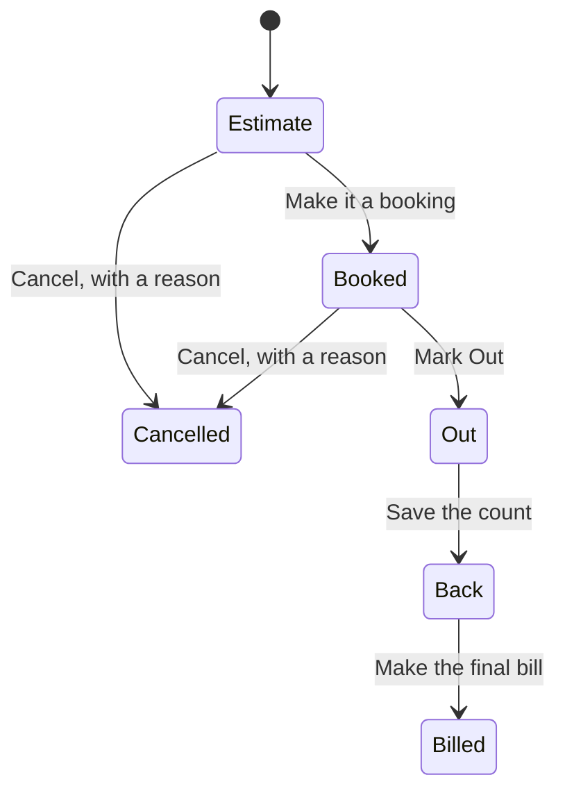

# Modules

What the system does, part by part, and when each part is built.
Order of work: `docs/PLAN.md`. Words: `docs/GLOSSARY.md`. Each part's rules:
`docs/rules/<part>.md`, written when its building starts.

---

## The business

The client rents out event serving equipment (counters, serving vessels,
cloths and premium showpieces) from one godown. Most bookings come from
other event management companies; sometimes a party books directly. The
team also sets the items up at the venue, and can supply service staff. The
business earns rent for the items, extra charges (transport, loading and
unloading, washing, setup and service staff), and the purchase price of any
piece that comes back broken or never comes back.

**The client's own rules for the system**
1. **Availability is always right.** Nobody can promise pieces that are
   already out or booked.
2. **Stable.** No surprises, no lost data, no "the system is down" in the
   busy season.
3. **Easy for every user**, from the owner to the godown manager: simple
   screens, few steps, no training manual.
4. **No complications.** Late payments, missing pieces coming back and a rare
   borrowed item are handled simply, without extra parts.

**When:**
- **Release 1:** built now; each part goes live as soon as it is built and
  checked
- **Release 2:** after Release 1 is stable
- **Later:** ready in the structure, switched on when needed

---

## Release 1

| Part | What it does | App |
|---|---|---|
| Users and roles | Four roles sign in: Owner (sees and does everything), Accountant (final bills, extra charges, discounts, round-off, payments, balances), Office Staff (customers, estimates, follow-ups, bookings, sending the Missing & Damage bill), Godown Manager (stock, without purchase prices (point 2 below), delivery, the return check, the Missing & Damage list). Users are not staff. Who may do what: `docs/rules/roles.md` | `users` |
| Business, branch and godown | One business, one branch, one godown today. Nobody sees them until a second godown or branch exists | `businesses` |
| Stock | Items with a photo, name, category, stock, purchase price and rent. Four categories: Counters, Serving Vessels, Cloths, Premium | `stock` |
| Availability | How many pieces of each item are available at any time: not held by a booking, not out, not missing. A day shows its lowest count (ADR-0013). A missing piece is not available; once recovered it is available again; once charged it leaves the stock | to decide (`docs/ARCHITECTURE.md`) |
| Customers | Event companies and direct parties, added once and picked after | `customers` |
| Estimates and follow-ups | The price offer, with the rent from the stock list and what is available over the booking's trip; reminders to call the customer back. Estimates go out at the normal rent | `bookings` |
| Bookings | An estimate becomes a booking, edited if anything changed. The booking holds its pieces from its loading time to its expected back time (ADR-0013), and keeps the event details: event date, venue, setup date and time, loading time, expected back, site manager, service staff needed | `bookings` |
| Godown out and return | The Loading Sheet, printed in clear black and white; Out in one step; the return check in the sheet's order; the Missing & Damage list and its bill; Recovered | `godown` |
| Accounts and bills | Extra charges (one typed total each), the discount (only the Accountant or the Owner), the round-off, the final bill, payments in any pattern, the balance | `bills` |
| Borrowed items | Lines on a booking for an item taken from another event group: not stock and no effect on availability, but on the delivery and return lists, and on the bill with their cost to us | `bookings` |

## One booking, start to finish

Who does each step, on which screen, and the booking's status after it.
The Owner may do every step. Screens: `docs/SCREENS.md`. Who may do what:
`docs/rules/roles.md`.

| # | Step | Who | Screen | Status after |
|---|---|---|---|---|
| 1 | Add the customer, or pick one who exists | Office Staff | New estimate | |
| 2 | Make the estimate. The system shows what is available over the booking's trip | Office Staff | New estimate | Estimate |
| 3 | Send it to the customer | Office Staff | Estimate paper | Estimate |
| 4 | Follow-ups until the customer decides. If they say no, the estimate is cancelled, with its reason | Office Staff | Bookings, then the estimate | Estimate, or Cancelled |
| 5 | The estimate becomes a booking, edited if needed. Availability is checked again, and its pieces are now held | Office Staff | The estimate: Make it a booking | Booked |
| 6 | Record an advance, if one is paid | Accountant | The booking: Add payment | Booked |
| 7 | Print the Loading Sheet, and tick each item on paper while loading | Godown Manager | Godown, or the event details box | Booked |
| 8 | Mark the booking Out, in one step, correcting any line that loaded short | Godown Manager | Mark Out box | Out |
| 9 | The sheet goes with the site manager. The team sets up at the venue; the event happens; service staff work there if booked | Site manager, on paper | | Out |
| 10 | The items come back. Count everything again: the return check | Godown Manager | Return check | Out |
| 11 | The site manager checks by hand against the same sheet | Site manager, on paper | | Out |
| 12 | Check any difference again, and save the final count. The Missing & Damage list is made from it | Godown Manager | Return check | Back |
| 13 | Send the Missing & Damage list and its bill to the customer | Office Staff | Missing & Damage bill | Back |
| 14 | A missing piece brought back, or collected by our staff, is marked Recovered once it is in the godown, and taken off the bill | Godown Manager | The booking | Back |
| 15 | Add the extra charges; give a discount, if any; choose the round-off | Accountant | Final bill | Back |
| 16 | Make the final bill: rent, plus extra charges, plus missing and damage, minus the discount, plus or minus the round-off. Missing and broken pieces still open are charged, and leave the stock | Accountant | Final bill | Billed |
| 17 | Payments, in any pattern, until the balance is 0 | Accountant | Final bill, or the booking: Add payment | Billed, then Paid |

- **Not back yet** is a booking still Out after its expected back time. It
  is worked out, never saved, and shows in red until the return check.
- **Balance due** and **Paid** are a billed booking with a balance above 0,
  or of 0. Worked out from the payments, never saved.
- A payment can come at any status, before or after the final bill.
- A cancelled estimate or booking is kept, with its reason; its pieces are
  free again. An advance paid on it: point 20.
- Each change of status keeps its time and who made it
  (`docs/ARCHITECTURE.md`, History).

---

## Release 2

| Part | What it does | App |
|---|---|---|
| Staff and salary | Staff by type (monthly salary, daily wage, temporary); staff given work on a booking (site manager, setup crew, service boys), matched against the service staff needed; attendance; wages, salaries, advances and payments; the real profit of each booking | `staff` |

**Release 1 is ready for it,** so nothing from Release 1 is changed or typed
again:
- The booking is the centre of everything, with its event details and the
  service staff needed.
- Users and staff are separate. A user can later be linked to a staff
  record.
- Every booking can carry costs, not just income. Borrowed items already do.
- The service staff charge is a bill line from day one.
- Everything belongs to a branch, staff included.
- Nothing is ever deleted: cancelled or changed records are kept and marked.

## Later

| Part | What it does | App |
|---|---|---|
| GST bills | A bill can become a GST bill when the business needs one. Tally stays with the accountant: no accounting is rebuilt | `bills` |
| More godowns and branches | A second godown, with stock seen together and items moved between them; a separate branch with its own godowns, stock and accounts. A place that must share nothing is a separate business (ADR-0012) | `businesses` |
| SaaS business features | Other rental businesses use the system as a paid service: sign-up, subscription billing, a platform admin panel, module switches. Only when a second business wants it (ADR-0012) | to decide |

---

## Points to settle, with the default we use

None of these blocks the work. Each has a default, used until the client
answers, and is confirmed in its part's rules. Every point is still to
confirm. The client gets them in one list; points 8 and 9 wait for
Release 2 and later.

| # | Point | Default |
|---|---|---|
| 1 | Are missing pieces charged at the purchase price, the same as broken ones? | Yes, the same rule |
| 2 | Can Office Staff and the Godown Manager see purchase prices? | Only the Owner and the Accountant see them. Office Staff see a charge only on the Missing & Damage bill they send; the Godown Manager sees none |
| 3 | Does an event over several days still pay rent once? | Yes, once per booking |
| 4 | Is a printed or shared delivery note needed when items go out? | A simple delivery list, printable and shareable |
| 5 | Will the field marketing team use phones for customers and estimates? | Yes: the sales screens work well on phones |
| 6 | Are premium items counted, or followed piece by piece? | Counted, like other items |
| 7 | The owner dashboard, and WhatsApp sharing of estimates and bills, in Release 1? | Decided in the plan; both are cheap to add |
| 8 | Monthly-salary and fixed staff: one group or two? | Release 2 only |
| 9 | A future separate branch: shared customers? Does the owner see all branches together? | Future only |
| 10 | Are setup and service staff charged apart on the bill, or included in the rent? | Separate optional lines, left empty if included |
| 11 | If more items are sent later on a second trip? | A small extra Loading Sheet for just those items |
| 12 | When does a load usually leave the godown, and when are the pieces back? (ADR-0013) | It leaves 2 hours before the setup time, and is back at 11:00 AM the day after the last event day. The office can change both on a booking |
| 13 | Can pieces go out again as soon as they are back, or do some need time first, like cloths for washing? | Ready again as soon as they are back and counted |
| 14 | A load not back yet keeps its pieces held until they are counted, so nobody promises pieces that are not in the godown | Yes |
| 15 | Does an unpaid bill show on its event day in the calendar, with a rupee sign? | Yes, for each role that sees money |
| 16 | Who may do what (`docs/rules/roles.md`) | As in that table |
| 17 | Does a customer often say yes on the first call, with no estimate sent? | The New estimate screen can also save it as a booking at once |
| 18 | Who records payments? | The Accountant and the Owner |
| 19 | How do customers pay? | Cash, UPI, bank transfer or cheque |
| 20 | A booking with an advance is cancelled: is the advance given back? | The Owner decides each time; the Accountant records what is given back |
| 21 | Do the pieces of one booking come back in one trip, or in parts? | In one trip: counted once, when everything is back |
| 22 | Where is the printer for the Loading Sheet: in the godown or in the office? | In the godown; the Godown Manager prints it |
| 23 | Is the stock list in an Excel sheet today? | If so, it is loaded once, through the same checks as Add an item. If not, the client's team types it in the app. The team adds the photos either way |
