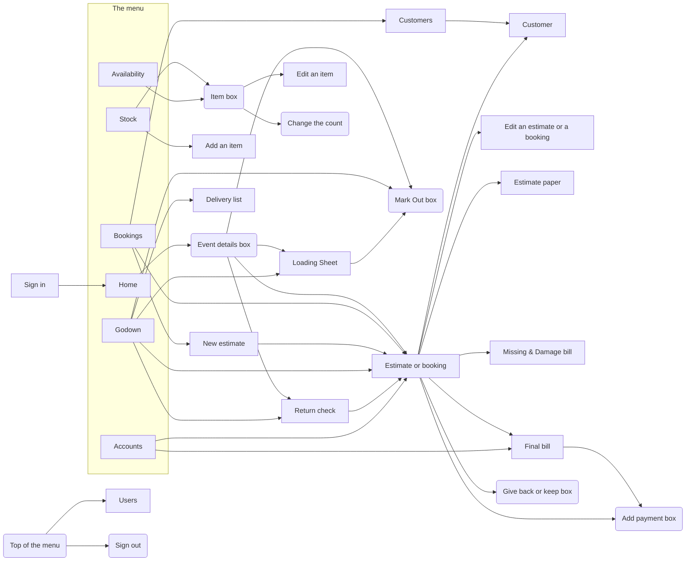

# Screens

Every screen of Release 1: who opens it, and how the screens link. Each
role's menu comes from this list. Who may do what on a screen:
`docs/rules/roles.md`. How screens look: `docs/DESIGN.md`. Words:
`docs/GLOSSARY.md`.

- A screen comes with its part, in the step named beside it
  (`docs/PLAN.md`). A screen that is not built yet has no menu item and no
  link.
- A box opens over the screen it comes from, so the person never loses
  their place.
- Each part's loop checks its own screens again before it builds them
  (`CONTRIBUTING.md`).

---

## Each role's menu

| Role | Menu, in this order |
|---|---|
| Owner | Home, Availability, Bookings, Godown, Accounts, Stock |
| Office Staff | Home, Availability, Bookings, Stock |
| Godown Manager | Home, Godown, Availability, Stock |
| Accountant | Home, Accounts, Bookings, Stock |

- The top of the menu shows the signed-in role and the person's name,
  beside the first letter of the name in a circle. A tap on it opens Sign
  out, and for the Owner also Users.
- The Accountant has Stock to change rents and purchase prices
  (`docs/rules/roles.md`).
- A phone shows at most five items in its menu bar. The Owner's sixth,
  Stock, is then reached from Godown, unless the page base (step 1) finds a
  better way.
- Customers are reached from Bookings and from a booking, not from the
  menu.
- Until Home is built (step 4), signing in opens the first part that is
  live.

## Every screen

| Screen | Who opens it | What it is for | Step |
|---|---|---|---|
| Sign in | anyone signed out | Start using the system. How each role signs in, and any screen that needs, comes with the sign-in ADR | 1 |
| Users | Owner | Add a user with a role, turn one off, set a new password | 1 |
| Stock | every role | One card per category, with search | 3 |
| Item box | every role | The photo, the rent, where the pieces are, who has them, the next three weeks, and every count change | 3 |
| Add an item | Owner, Office Staff, Godown Manager | Photo first, big category buttons, similar names shown, Save and add another | 3 |
| Edit an item | every role | Each role sees only the boxes it may change | 3 |
| Change the count | Owner, Godown Manager | Pieces in or out, with why | 3 |
| Home | every role | The month calendar, then every booked event from today on, nearest first. No money | 4 |
| Event details box | every role | The event card opened up, with no money: a problem first, the venue with Map and Share, the trip with its times, the hand-overs, the load, and Open the booking. The Owner and the Godown Manager get their next step at its stop, on the day it is due | 4 |
| Availability | Owner, Office Staff, Godown Manager | What is available on a day, by category, with search | 4 |
| Bookings | Owner, Office Staff, Accountant | The follow-ups due, then estimates and bookings by event date, with search and filters | 4 |
| New estimate | Owner, Office Staff | The customer, the event details and the items, with what is available over the booking's trip | 4 |
| Estimate or booking | every role | Its journey as steps, with the one next step for this role; its pieces; its event details; its money, except for the Godown Manager | 4 |
| Edit an estimate or a booking | Owner, Office Staff | The same boxes as New estimate | 4 |
| Estimate paper | Owner, Office Staff | The estimate, to print or share | 4 |
| Customers | Owner, Office Staff, Accountant | Every customer, with search | 4 |
| Customer | Owner, Office Staff, Accountant | One customer's details and bookings | 4 |
| Godown | Owner, Godown Manager | Today: to load, coming back, at events now, and the missing and broken pieces | 5 |
| Loading Sheet | Owner, Godown Manager | The printed sheet for one booking, or for a second trip's items | 5 |
| Delivery list | Owner, Godown Manager | The items sent, to print or share for the customer (`docs/MODULES.md`, point 4) | 5 |
| Mark Out box | Owner, Godown Manager | Out in one step, or correct a line that loaded short | 5 |
| Return check | Owner, Godown Manager | The count, in the Loading Sheet's order | 5 |
| Missing & Damage bill | Owner, Office Staff, Accountant | The missing and broken pieces with their charges, to print or share | 5 |
| Accounts | Owner, Accountant | Final bills to make, balances due, money on cancelled bookings still to give back, keep or move, and the payments of the last 7 days | 6 |
| Final bill | Owner, Accountant | The extra charges, the discount and the round-off; the bill to print or share | 6 |
| Add payment box | Owner, Accountant | Money received: the amount, the date and how it was paid, with one line for each way when it is mixed (`docs/MODULES.md`, point 19) | 6 |
| Give back or keep box | Owner, Accountant | On a cancelled booking with money paid: give it back, keep it, or move it to another booking (`docs/MODULES.md`, point 20) | 6 |
| Owner dashboard | Owner | Only if wanted in Release 1 (`docs/MODULES.md`, point 7) | 8 |

- Every screen also has the shared state pages: not found, not open to
  your role, server error, session expired, and offline
  (`docs/DESIGN.md`).
- Borrowed items have no screen of their own (step 7). They are lines on
  the estimate and the booking, and show on the Loading Sheet, the return
  check and the bills.
- Not placed yet: one search across items, customers and bookings, and a
  list of what needs the Owner. Both are decided with the owner dashboard.

## How the screens link

Square: a screen. Round: a box over the screen it comes from.

